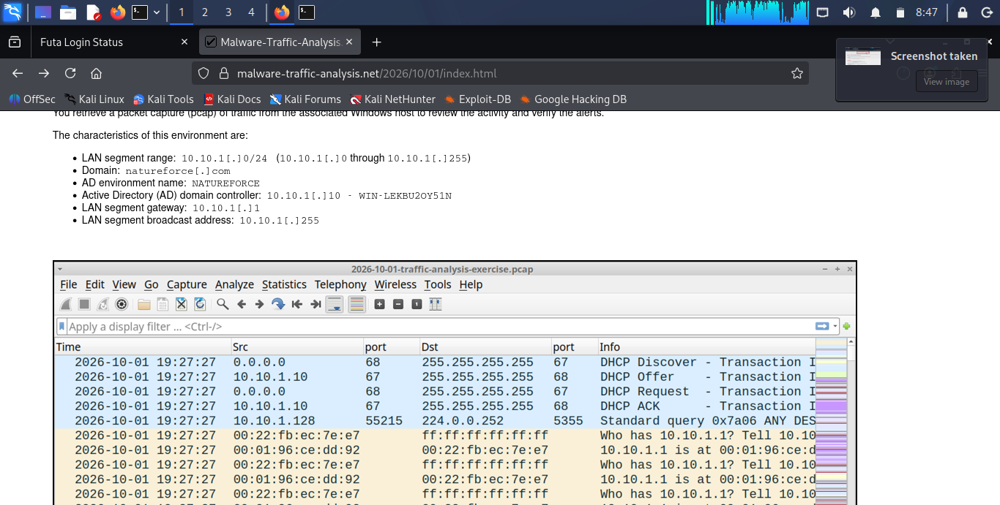
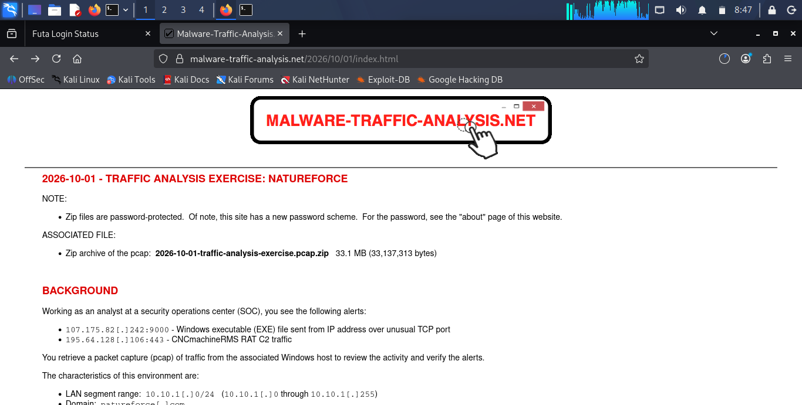
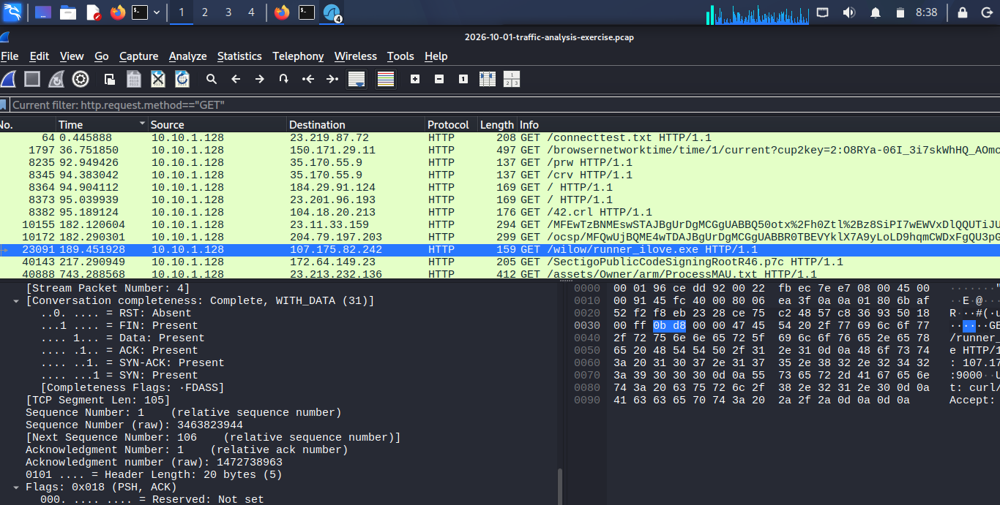

# MY REPORT 
# Incident Report: Infected Windows Host (NATUREFORCE LAN)

## Scenario

An analyst at the SOC received two alerts:

- `107.175.82[.]242:9000`: Windows EXE sent from an IP over an unusual TCP port
- `195.64.128[.]106:443`: CNCmachineRMS RAT C2 traffic

The pcap (`2026-10-01-traffic-analysis-exercise.pcap`) was reviewed in Wireshark to verify the alerts and identify the infected host.



**Environment:** LAN 10.10.1.0/24, domain `natureforce.com`, AD environment `NATUREFORCE`, domain controller `WIN-LEKBU2OY51N` (10.10.1.10), gateway 10.10.1.1.

## MY FINDINGS

| Item | Value |
|------|-------|
| **IP Address** | 10.10.1.128 |
| **MAC Address** | 00:22:fb:ec:7e:e7 (Intel_ec:7e:e7) |
| **Hostname** | DESKTOP-4VGYQX7 |
| **Username** | couldnt detect it  |
| **Malicious File** | runner_ilove.exe (from 107.175.82.242:9000) |
| **SHA-256** | `b789adce70c028a6d17be45ec34667aa95586350ee0c4057e75b138b1ad35061` |

## METHODOLOGY

### 1. IP Address
The infected Windows client is **10.10.1.128**. It receives its lease via DHCP from the domain controller (10.10.1.10) and is the source of the LLMNR query and the HTTP request to the malicious server.



### 2. MAC Address
The ARP traffic shows 10.10.1.128 using MAC **00:22:fb:ec:7e:e7** (vendor: Intel). The Ethernet source field of the HTTP GET request confirms the same address.



### 3. Hostname
Frame 5 is a Link-Local Multicast Name Resolution (LLMNR) query from 10.10.1.128 to 224.0.0.252. The hostname is **DESKTOP-4VGYQX7**.

### 4. Malicious Executable and Hash
Filtering with `http.request.method=="GET"` shows frame 23091, a request from 10.10.1.128 to 107.175.82.242 for `/wilow/runner_ilove.exe` (port 9000, matching the alert).


The file was extracted with `File > Export Objects > HTTP` and hashed:

```bash
sha256sum runner_ilove.exe
```

b789adce70c028a6d17be45ec34667aa95586350ee0c4057e75b138b1ad35061 runner_ilove.exe


## CONCLUSION

The Host **DESKTOP-4VGYQX7** (10.10.1.128, MAC 00:22:fb:ec:7e:e7) downloaded `runner_ilove.exe` from 107.175.82.242:9000 over HTTP and should be treated as compromised. Upon checking 107.175.82.242 on virus total, it has been involved with many threat and attacks. 

**Recommended actions: isolate the host, reset the affected user's credentials, and block 107.175.82.242 and 195.64.128.106 ( and ensure the IPS/IDS/Firewall rules are updated to block these IPs).**

---
**I completed this activity under 56 mins but I could not detect the username of the host affected** 
